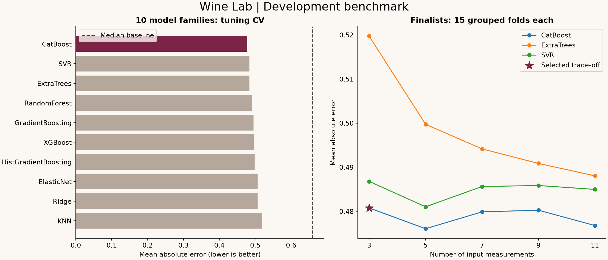
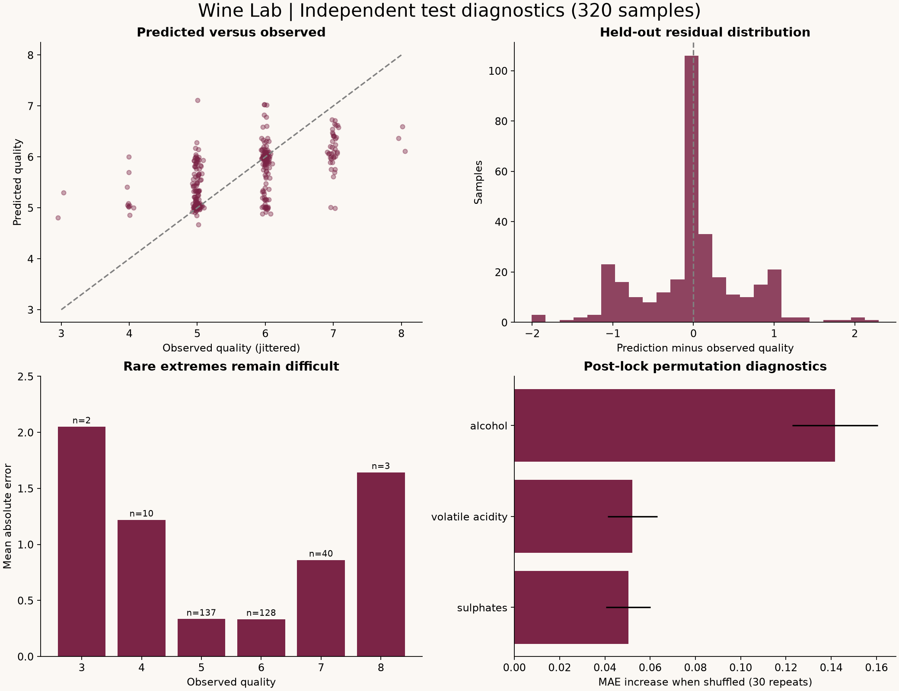
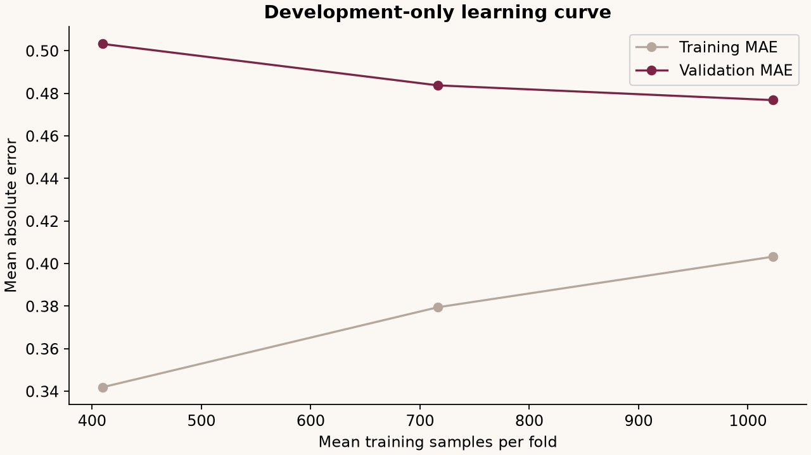

# Wine Lab model card

## Release decision

The promoted model is **CatBoost**, requiring only **volatile acidity, sulphates, alcohol**.
It is the selected MAE-versus-input-burden trade-off within this benchmark, not a claim of universal optimality.
The search covered 10 model families, 114 configurations, and 15 feature-count/family finalists.
Only this champion is saved for inference; all challenger configuration and evaluation evidence remains in reports.

The all-11-input CatBoost had repeated-CV MAE 0.4768;
the selected 3-input version had 0.4808, a change of +0.0040.
Before training we declared a 0.005-point MAE tolerance for selecting fewer inputs. This is an engineering tolerance,
not a statistical equivalence test. Removed inputs may still contain signal; they were not needed for this trade-off.
Reduced subsets reuse the tuned full-input hyperparameters, so this is a bounded search rather than exhaustive subset optimization.

## Independent evaluation

| Metric | Champion | Training-median baseline |
| --- | ---: | ---: |
| MAE | 0.4502 | 0.6531 |
| RMSE | 0.6526 | 0.8786 |
| R-squared | 0.3328 | -0.2095 |
| Median absolute error | 0.2817 | 1.0000 |
| Within 0.5 point | 61.3% | 40.0% |
| Within 1 point | 86.9% | 95.3% |
| Bias | -0.0034 | +0.3656 |
| 90th percentile absolute error | 1.0206 | 1.0000 |

MAE improved 31.1%. The group-bootstrap 95% MAE interval is
[0.3958, 0.5096]. The paired baseline-improvement interval is
[0.123459439079016, 0.276085586332255]. These are uncertainty estimates for aggregate test performance,
not individual prediction intervals, and are conditional on this dataset and split.
The release passed the predefined gate: at least 5% lower MAE than baseline and a positive lower paired-bootstrap improvement bound.
The baseline wins the within-one-point metric; model superiority depends on the chosen objective.
No challenger was evaluated on the final test set. The deployed artifact is the exact model evaluated here, with no test-data refit.

## Data and validation

- Source: user-supplied UCI red wine CSV, 1,599 rows, 11 original predictors, no missing cells.
- 240 repeated rows; 1,359 unique predictor groups. No conflicting quality labels within identical predictors.
- Development: 1279 rows. Test: 320 rows / 272 identity groups.
- Fixed seed 42; test is the first fold of 5-fold shuffled StratifiedGroupKFold.
- Identical predictor tuples never cross any train/validation/test boundary. This controls exact-duplicate leakage,
  but unavailable producer/vintage/batch identities could still hide dependence.
- Model tuning: 5 grouped folds, fixed randomized search. Feature robustness: 5 folds at each of seeds 42, 17, and 2026.
- Feature ranking, scaling, and estimator fitting occur only within each training fold.
- Development folds are reused for model selection and are optimistically biased; the untouched test assesses the locked procedure.
- Bootstrap: 2,000 paired resamples of identity groups. Unique-group-weighted test MAE is 0.4609.
- Raw predictions are continuous and unrounded. Quality is ordered, but this release optimizes regression MAE.

## Model family comparison (development tuning)

| Family | CV MAE | CV RMSE | Configurations |
| --- | ---: | ---: | ---: |
| CatBoost | 0.4777 | 0.6458 | 12 |
| SVR | 0.4841 | 0.6477 | 12 |
| ExtraTrees | 0.4843 | 0.6298 | 12 |
| RandomForest | 0.4917 | 0.6353 | 12 |
| GradientBoosting | 0.4954 | 0.6375 | 12 |
| XGBoost | 0.4963 | 0.6371 | 12 |
| HistGradientBoosting | 0.4982 | 0.6426 | 12 |
| ElasticNet | 0.5069 | 0.6521 | 12 |
| Ridge | 0.5069 | 0.6523 | 6 |
| KNN | 0.5196 | 0.6619 | 12 |

The baseline development CV MAE is 0.6591.

## Feature-count comparison (15 development folds)

| Family | Input count | CV MAE | CV RMSE |
| --- | ---: | ---: | ---: |
| CatBoost | 5 | 0.4761 | 0.6523 |
| CatBoost | 11 | 0.4768 | 0.6473 |
| CatBoost | 7 | 0.4799 | 0.6540 |
| CatBoost | 9 | 0.4803 | 0.6526 |
| CatBoost | 3 | 0.4808 | 0.6689 |
| SVR | 5 | 0.4810 | 0.6480 |
| SVR | 11 | 0.4850 | 0.6468 |
| SVR | 7 | 0.4856 | 0.6482 |
| SVR | 9 | 0.4859 | 0.6483 |
| SVR | 3 | 0.4868 | 0.6612 |
| ExtraTrees | 11 | 0.4880 | 0.6350 |
| ExtraTrees | 9 | 0.4909 | 0.6385 |
| ExtraTrees | 7 | 0.4942 | 0.6414 |
| ExtraTrees | 5 | 0.4997 | 0.6443 |
| ExtraTrees | 3 | 0.5197 | 0.6677 |

Feature subsets are ranked anew inside each fold; this evaluates a selection procedure, not one globally preselected subset.
The production subset is frozen from the development-only fit. Repeated folds overlap; their standard deviations are descriptive,
not independent standard errors or evidence of statistical equivalence.

## Failure analysis

| Observed quality | Test samples | MAE | Bias |
| --- | ---: | ---: | ---: |
| 3 | 2 | 2.050 | +2.050 |
| 4 | 10 | 1.219 | +1.219 |
| 5 | 137 | 0.334 | +0.320 |
| 6 | 128 | 0.333 | -0.171 |
| 7 | 40 | 0.861 | -0.861 |
| 8 | 3 | 1.643 | -1.643 |

The model pulls rare extreme scores toward common scores. Only 2 test wines scored 3 and 3 scored 8;
estimates at those extremes are highly uncertain. This is not a reliable detector of exceptional or very poor wines.
Within-score R-squared is undefined and reported as null.
No hard safety, purchasing, or release decision should be inferred from the predicted score alone.

## QA and reproducibility

Local recorded QA: **93 tests, 0 failures/errors**. Tests cover input integrity, target exclusion, duplicate grouping,
all fold boundaries, training-only scaler/selector fitting, all model families, metric known answers,
bootstrap determinism, selection rules, release gate, artifact and dataset checksums, golden predictions,
batch consistency, malformed inputs, range warnings, and API request/response behavior.
The separate locked-model reproduction command rebuilds from development rows and checks golden predictions.

The group-shuffled-label negative control scored MAE 0.6949,
versus 0.6826 for its median baseline: no useful signal remained.
This is one smoke-control permutation, not a formal permutation hypothesis test.

## Use and limitations

Use the model to explore sensory quality estimates for measurements resembling Portuguese red Vinho Verde wines.
It does not establish causality, health/safety, market value, quality of white wines, or transfer to other regions.
Feature permutation is a post-lock diagnostic; correlated inputs and small test samples limit interpretation.
Only single-feature training-range checks are implemented; plausible ranges do not guarantee an in-distribution combination.
No calibrated individual prediction interval is provided. No generative AI is used in prediction.
Additional independent contemporary samples are the next requirement for stronger generalization evidence.

## References and disclosure

Dataset: Cortez, P., Cerdeira, A., Almeida, F., Matos, T., and Reis, J. (2009),
[Wine Quality, UCI](https://doi.org/10.24432/C56S3T), CC BY 4.0.
The supplied CSV uses comma separators and is preserved byte-for-byte.
Implementation, documentation, and analysis were produced with OpenAI Codex from user prompts.
Libraries and upstream algorithms are listed in the exact dependency lock; modeling code uses no application template. The web frontend uses the OpenAI Sites Vinext starter, React, and Lucide icons.
