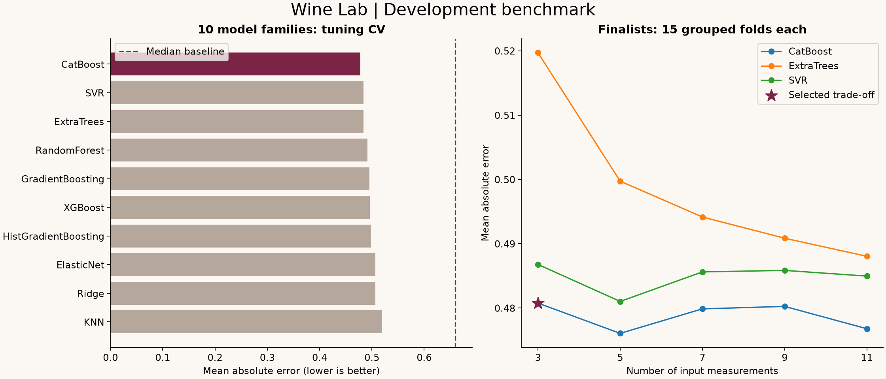

# Wine Lab: red wine intelligence app

[](https://github.com/gregflamelit/testing3/actions/workflows/ci.yml)

**[Open the deployed Wine Lab app](https://wine-lab-gregflamelit.greg125769.chatgpt.site)** — owner-private; use the same ChatGPT account that owns the Site.

The live prediction, batch comparison, and analytics screens were verified in a signed-in browser.
[All four release CI jobs passed](https://github.com/gregflamelit/testing3/actions/runs/42545668016):
web tests/typecheck/build, Linux ML QA/reproduction, Windows ML QA/reproduction, and Docker HTTP inference.
The release includes 40 app tests plus the existing 93 Python tests, and 6,388 cross-runtime prediction parity cases.

Predict sensory wine quality with three measured inputs, compare CSV batches, and inspect the model evidence.
The complete React app is in `web/`, backed by the exact released CatBoost model and preprocessing.
The repository also includes a reproducible 10-family benchmark and the original Python inference service.

## Web app

- **Prediction:** three inputs with sliders and numeric entry, examples, stale-result handling, range warnings, and CSV export.
- **Batch comparison:** CSV upload, robust validation, up to 5,000 samples, 500-sample inference chunks,
  sorting/search/filtering, pagination, up to three side-by-side samples, and full CSV export.
- **Analytics:** model-family benchmark, input-count comparison, test metrics/baseline, rare-score errors,
  predicted-versus-observed plot, and downloadable evaluation evidence.

The app's same-origin `/api/predict` route evaluates the fitted 300-tree ensemble and scaler exported
from `artifacts/champion.joblib`. It does not fit a replacement model. A 6,388-case parity test checks agreement
with Python to within 1e-10, including every dataset row, randomized measurements, and split-boundary probes.
Uploads are parsed in the browser. Sample labels and optional observed scores never enter the prediction request.
Observed-file metrics are clearly distinguished from the independent model-release evaluation.

See [web setup and deployment](web/README.md). Sites hosting begins owner-private; GitHub holds the complete source.
The original Docker/Python service remains available as a separate deployment option.

**Selected champion: CatBoost using volatile acidity, sulphates, and alcohol.**

| Held-out metric | Champion | Median baseline |
| --- | ---: | ---: |
| Mean absolute error | **0.4502** | 0.6531 |
| Root mean squared error | **0.6526** | 0.8786 |
| R-squared | **0.3328** | -0.2095 |
| Within half a quality point | **61.25%** | 40.00% |
| Within one quality point | 86.88% | **95.31%** |

The champion reduces MAE by **31.1%** on 320 held-out samples, with group-bootstrap 95% MAE interval
**[0.3958, 0.5096]**. It passed the predefined baseline-improvement release gate.
The model is less reliable at rare extreme scores and does not dominate every metric.

## Why this model moved forward

We compared Ridge, ElasticNet, KNN, SVR, Random Forest, Extra Trees, Gradient Boosting,
Histogram Gradient Boosting, XGBoost, and CatBoost, plus a training-median baseline.
Hyperparameters were tuned on five grouped development folds. The top three families were then
evaluated with 3, 5, 7, 9, and 11 inputs over 15 grouped folds each.

The three-input CatBoost had repeated-CV MAE 0.4808 versus 0.4768 with all 11 inputs.
The selection rule declared before training accepts up to 0.005 MAE for fewer required measurements.
Eight inputs were removed under that rule. This is a practical accuracy/input-burden trade-off;
it does not prove those measurements are universally irrelevant or that this is a globally optimal model.
All challenger code and results are retained; only the champion is serialized for deployment.

[Read the complete model card](MODEL_CARD.md) for all model comparisons, feature tests,
uncertainty estimates, rare-score errors, learning curves, and limitations.



## Reproduce locally

Use Python 3.12. The recorded run used Python 3.12.14. In a fresh virtual environment:

```bash
python -m venv .venv
# Activate: Windows PowerShell .\.venv\Scripts\Activate.ps1
# Activate: macOS/Linux source .venv/bin/activate
python -m pip install -r requirements.lock.txt
python -m pip install -e . --no-deps
python -m pytest -q
python -m wine_lab.reproduce
python scripts/smoke_api.py
```

The locked reproduction command trains only on the original development split, using the frozen
champion settings and selected inputs. It verifies agreement with saved golden predictions and
writes a separate `.cache/rebuilt_champion.joblib`; it does not replace the release artifact.
On Linux, CatBoost may require the system `libgomp1` package; the Dockerfile installs it.

Re-run the entire benchmark into a new directory:

```bash
python -m wine_lab.train --output experiment-output --jobs 4 --draws 12
```

Full benchmark runs refuse to overwrite a directory that already consumed its final test set.
The manual **Reproduce full benchmark** GitHub Actions workflow runs this command and uploads results;
it never promotes a new model automatically. Reusing this public dataset cannot restore an independent
test set for future model-development decisions. New independent data is required for a new unbiased evaluation.

## Predict from CSV

```bash
python -m wine_lab.predict examples/samples.csv predictions.csv
```

Input columns must be exactly `volatile acidity,sulphates,alcohol` in any order.
The `quality` target and removed fields are rejected. Inputs must be finite nonnegative numbers;
out-of-training-range values produce warnings. Predictions remain continuous and unrounded.
The reference test MAE returned with predictions is an aggregate performance measure, not an individual confidence interval.

## Run the inference service

```bash
uvicorn wine_lab.api:app --host 127.0.0.1 --port 8000
```

Open [the local API documentation](http://127.0.0.1:8000/docs). Routes:

- `GET /health`: model loaded and ready.
- `GET /model`: selected schema, metrics, scope, ranges, and version.
- `POST /predict`: between 1 and 1,000 samples, in input order.

Example body:

```json
{
  "samples": [
    {"volatile acidity": 0.7, "sulphates": 0.56, "alcohol": 9.4}
  ]
}
```

Or package the model service:

```bash
docker build -t wine-lab-model .
docker run --rm -p 8000:8000 wine-lab-model
curl http://localhost:8000/predict -H "Content-Type: application/json" --data-binary @examples/request.json
```

The repository is the requested GitHub delivery. The container is ready for an application host;
this release does not claim a publicly hosted API endpoint. The CI container job builds it and exercises real HTTP inference.

## Validation and QA

- 1,599 samples; 240 repeated rows; no missing measurements. No target is used as a predictor.
- Split by exact 11-input identity: duplicates cannot cross development/test or any CV fold.
- Development set: 1,279 rows. Test set: 320 rows / 272 unique groups. Fixed seed: 42.
- Ranking, feature selection, and scaling are fitted inside training folds only.
- A selection lock is written before testing. Only the locked champion and baseline see test labels.
- MAE drives selection; RMSE, R-squared, error quantiles, bias, score-level errors, and two accuracy bands provide context.
- 2,000 paired group-bootstrap resamples quantify aggregate uncertainty and baseline improvement.
- A group-shuffled-target smoke control, learning curves, and unique-group-weighted metrics supplement evaluation.
- Local QA recorded **93 passing tests**, plus independent locked-model retraining with golden-prediction verification.
- CI runs the suite and reproduction on Linux and Windows, and builds/smoke-tests the container.

`reports/qa-results.xml` records local results; the CI badge and Actions logs show remote verification separately.
No test result can establish generalization to another region, vintage, or producer. Group identities at those levels are unavailable.

## Repository contents

| Path | Purpose |
| --- | --- |
| `data/` | Exact supplied CSV, source attribution, and license |
| `src/wine_lab/train.py` | Tuning, grouped CV, feature reduction, selection lock, one-time test, release gate |
| `src/wine_lab/models.py` | Every candidate family and fold-local feature selector |
| `src/wine_lab/data.py` | Data contracts, checksums, grouping, deterministic splits |
| `src/wine_lab/metrics.py` | Analytics and paired group bootstrap |
| `src/wine_lab/predict.py`, `api.py` | Champion-only inference and HTTP service |
| `src/wine_lab/reproduce.py` | Rebuild the locked champion and verify predictions |
| `src/wine_lab/report.py` | Regenerate charts and model card from saved results |
| `artifacts/` | One champion, metadata/checksums, golden prediction fixtures |
| `reports/` | Every tuning trial, feature comparison, split/fold assignments, predictions, diagnostics, QA |
| `tests/` | Data, pipeline, metrics, release integrity, and API tests |

## Data and tools

Dataset: Cortez et al. (2009), [UCI Wine Quality](https://doi.org/10.24432/C56S3T),
[CC BY 4.0](https://creativecommons.org/licenses/by/4.0/). The supplied comma-separated copy is preserved byte-for-byte.
See [data provenance](data/README.md). Exact library versions are in `requirements.lock.txt`.

OpenAI Codex generated the implementation, tests, documentation, and analysis from user prompts.
The web app uses the OpenAI Sites Vinext starter, React, and Lucide icons; modeling code uses no application template.
No chatbot, generative model, paid prediction API, or prediction credential is required.
Joblib artifacts should only be loaded from a trusted source; the release loader verifies the recorded SHA-256.
